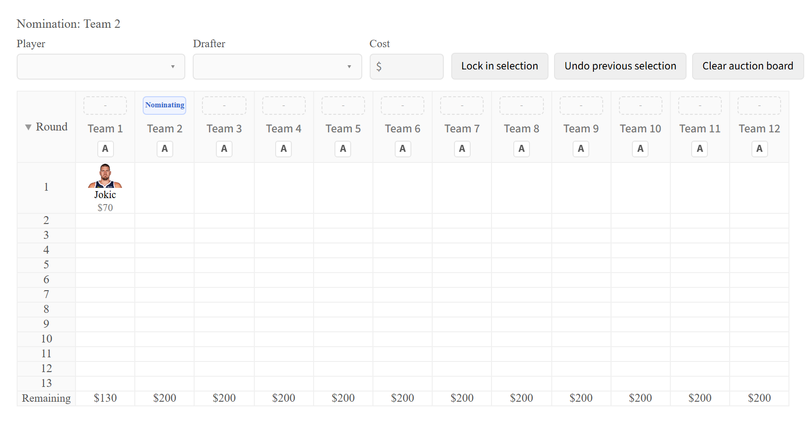
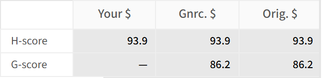
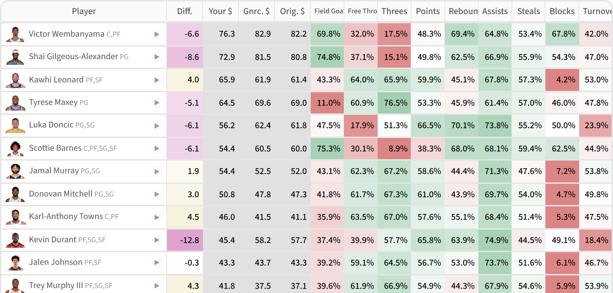
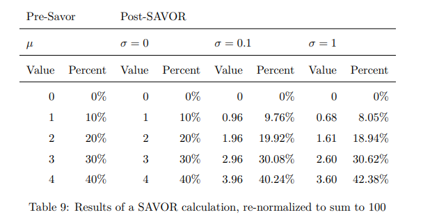

# Auction Mode

Auction drafters need to decide how much to bid on players, not just which players to take. That makes a pure rank ordering, like what is produced for snake drafting, insufficient for strategic decision making in the auction context. 

To be helpful for auctions, the website leverages the machinery of H-scoring to estimate player values both generically and for the manager in question's team. This gives managers both overall value estimates of how much they should be willing to bet on players, and also a sense of which players benefit them more than they benefit the field. Even if the exact dollar values are inexact, the differentials between personal and generic value can point towards players to bid for. 

## Using auction mode 

When the selected mode from the left sidebar is 'Auction Mode', the website will provide analysis for either synthetic or live auctions. 

### Manual entry 

Player selection information can be entered into the table through the selectors above it. Teams can also be toggled to autodraft using the 'A' button next to each team name in the column headers. Autodrafters rotate nominations, opening the bidding at $1. Drafters then take turns in set circular order bidding $1 higher whenever the price remains within their budget and calculated valuation; otherwise, they must pass and can no longer bid on that player. Bidding among the autodrafters is settled at once, so manual drafters are first asked at the price the autodrafters reach on their own (the second-highest autodrafter's limit, or $1 above it); no lower manual bid could win. From there, non-autobidders have one turn per cycle to either pass, increase the bid by $1, or optionally increase the bid by more. Bidding continues until everyone else passes and one player wins.

### Live connection 

Yahoo auctions can be integrated with the website, like drafts. 

For some reason, Yahoo's API does not return anything for auctions until a few minutes after the auction has started. Because of that, the displayed values may be the default values for the first few picks. Besides that, the integration works much the same way as for drafting mode. 

## Quantifying auction value

The concept of estimating player values for auctions is not new. A well known heuristic is described in many places including [this article from rotowire](https://www.rotowire.com/basketball/article/nba-auction-strategy-part-2-21393). It converts player strength quantified by something like Z-score into an equivalent dollar value, and it is the basis for evaluating players in the auction context. 

The standard method for estimating auction value is

1. Calculate the replacement-level score. That is, if 156 players will be chosen, the 157th-highest score is the replacement value
2. Adjust all scores by subtracting out the replacement-level value. If this would make a score go below zero, set it to zero instead
3. Calculate the sum of scores above replacement. This is the total amount of real value available in the auction
4. Divide the total number of dollars available by the total amount of real value available. This yields a conversion rate from score above replacement to dollars
5. Multiply each players' score above replacement with the conversion rate calculated in the previous step. The result is each players' auction value

This process ensures both that players' dollar values are proportional to their values over replacement, and that the total of all players' dollar values are equal to the total amount of $ available. 

The website uses a few different variations of this idea. Five different dollar value estimates can be found within players' detailed drop-downs. 

/// caption
All of the computed dollar estimates, from a detailed drop-down.
///

### Converting G-score value to dollar value 

The two $ value estimates for G-scores are the easiest to explain. Using any static ranking system to evaluate players is problematic, for reasons described in the [G-score](gscores.md) section. However, many auction drafters likely make bidding decisions based on static value, which motivates including that information for context. 

'Orig. $' value, or original value, is the auction value heuristic described above applied to total G-score on all players in the league. Original values do not change during auctions, and can be helpful as objective benchmarks that quantify how good deals are in the abstract. 

'Gnrc. $' value, or generic value, is a variant which is recomputed as players are taken and the amount of available money decreases. For example if two players out of 156 have been taken for $200 total, those two players are removed from the list, the replacement-level value becomes the 155th-highest score, and 200 dollars are removed from the amount of total dollars available. The same process as for original value is then applied using the modified inputs. Generic value can be useful strategically because it reflects whether other drafters have been under- or over-spending. E.g. if drafters have been underspending, it implicitly takes into account the fact that some drafters have excess money and will be able to pay more for remaining players. 

### Converting H-score value to dollar value 

The dollar estimates based on H-scores are more aligned with real value, and are featured more centrally on the website than the estimates based on G-scores. In addition to being available within player drop-downs, the H-score estimates are also shown in the main candidate table. 

The H-score-based estimates are also somewhat more complicated than the G-score equivalents. 

/// caption
H-score-based $ values for a manager who has already taken Jokic.
///

H-scores are probabilities, not general values. They are converted into dollar values with two steps

1. It is estimated how much money it would take to improve winning chances by the same amount as taking each player
2. Those monetary estimates are re-scaled with the auction value heuristic as described previously

Like for G-scores, the 'Orig. $' values are processed once with the auction value heuristic and stay the same throughout the auction. Neither step 1 nor step 2 changes. Since the values never change, the total value of 'Orig. $' left in a draft does not necessarily add up to the amount of money teams have left to spend. 

For 'Gnrc. $' value, the underlying step 1 estimates are not changed, but the step 2 process is adjusted for the number of players remaining etc. That is, if a player worth $30 of original value is still available, that number will continue to be plugged in as a value to the auction value heuristic process. That way, the total 'Gnrc. $' value left in the draft will always equal the amount of money managers have left to spend. 

For 'Your $', both step 1 and step 2 are re-run based on auction context for the manager in question. It is the only valuation that takes context, like the team's punt build, into consideration. 

The difference between 'Your $' and 'Gnrc. $', the 'Diff.' column,  highlights players which are more or less valuable to the drafter in question than they are to a generic drafter. Players with high values for 'Diff.' are likely sensible targets, while players with low values are anti-synergistic. 

**The long and short of it is: 'Your $' is a reasonable benchmark for what you should be willing to pay for a player. 'Diff.' highlights players that are particularly good for your team. 'Orig. $' is a context-agnostic benchmark of what constitutes a good deal for the player**

### The SAVOR adjustment 

After the previously described processing for H-score and G-score dollar values, the website makes an additional adjustment called SAVOR. It is reflected in all of the displayed dollar values. 

SAVOR stands for Streaming-Adjusted Value Over Replacement. It adjusts for the fact that the lowest-ranking players are highly likely to be shuffled around over the course of the season through waiver wires and free agency, so it is not worth spending much money on them, even if theoretically they are projected to be somewhat more valuable than their alternatives. The general concept is known within the fantasy basketball community- for example it is referenced in this [reddit thread](https://www.reddit.com/r/fantasybball/comments/16se6gt/auction_draft_observationsdata/). Low-value players are likely to be shifted around after snake drafts too, but there is no reason to actually make the SAVOR adjustment in the snake drafting context, because it is a monotonic transformation that would never influence candidate order. That is why it is unique to the auction context. 

<video controls preload="metadata" width="100%" poster="../videos/savor-poster.jpg">
    <source src="../videos/savor.mp4" type="video/mp4">
</video>
/// caption
A visual explanation of the SAVOR adjustment
///

SAVOR takes two input parameters, $S_{\sigma}$ (S-sigma) and $S_R$.

- $S_{\sigma}$ controls the degree to which players are expected to move up and down in dollar value across the season according to the SAVOR model.
- $S_R$ is the value of a streaming slot. SAVOR assumes that players actualize their value if they end up above $S_R$ after perturbation.

The default values of $10 and $2 are sourced by vibes- different values may be just as or more reasonable. 

??? note "What is the theoretical framework behind the SAVOR calculation?"

    Details of the SAVOR adjustment are included in the appendix of [an old version of the first paper](https://arxiv.org/abs/2307.02188v4). It was removed from the most recent version because it was not topical to the main point of the paper. 

    The first foundational idea is to model observations of player values as noisy estimates, which are resolved once the season begins. If a player is projected to be valuable before the draft but ends up being below replacement-level during the season, they will be replaced by a replacement-level player. 

    The second foundational idea is that value during an auction is relative to a player that could be picked up at the end for essentially no cost. These players are not useless- it is possible that they could end up being more valuable than projected, and turn into a meaningful asset. 

    Assuming that error between projected and realized value is a Normal distribution with a constant scale allows this situation to be modeled mathematically with relative ease. The result is the following formula 

    $$
    \mu \Phi\left(\frac{\mu}{\sigma}\right) - \frac{\sigma}{\sqrt{2\pi}}\left(1 - e^{-\frac{\mu^2}{2\sigma^2}}\right)
    $$

    This does not lend itself to intuition, but the simple explanation is that as the scale parameter is turned up, players projected to be valuable become even more valuable than their projection. The reason is that the small bump in mean expectation from a low value player versus a tail-end-of-the-auction player doesn't mean as much as a bump in mean expectation for a high-value player, because a significant fraction of the time, the real value of a low-value player will dip below the replacement threshold. That is highly unlikely to happen for high-value players.

    

    The original version of the SAVOR calculation had no $S_R$, it just assumed the cut-off for value was 0. When the calculation is traced through with $S_R$ as the cutoff, it becomes 

    $$
    (\mu - S_R)\,\Phi\left(\frac{\mu - S_R}{\sigma}\right) + S_R\,\Phi\left(-\frac{S_R}{\sigma}\right) + \frac{\sigma}{\sqrt{2\pi}}\left(e^{-\frac{(\mu - S_R)^2}{2\sigma^2}} - e^{-\frac{S_R^2}{2\sigma^2}}\right)
    $$

### Overbidding for packing efficiency 

The standard auction heuristic assigns dollar values to players such that their total value equals the amount of money in the pot. The implicit assumption in that formulation is that all teams will be able to spend all their money on players at those valuations. In reality, that is likely impossible: it would take luck to find thirteen players that add up to exactly $200. 

This inefficiency is felt most acutely when the number of options for players dwindles. If managers wait too long to spend their money, there might not be enough high-value players left for them to spend all of their money on. E.g. if a manager has $40 with two slots left, and the top two players are worth $20 and $10 to them, they will leave some money on the table no matter what. 

<video controls preload="metadata" width="100%" poster="../videos/cash-packing-poster.jpg">
    <source src="../videos/cash-packing.mp4" type="video/mp4">
</video>
/// caption
Motivation for the packing efficiency inflation factor
///

The website's heuristic fix for that is an inflation factor which increases the value of players as efficiency starts to get squeezed. It is calculated through a three-step process 

1. The base ratio $r_1$ is calculated. It is the team's spendable cash (its cash minus $1 per empty bench slot) over the base value of the top options (its top players, one per open slot).
2. The ratio is adjusted through a formula: $r_2 = 1 + s\ln\left(1 + e^{(r_1-1)/s}\right)$, where $s$ is a parameter
3. A player worth $v$ is given an extra $(r_2 - 1)\frac{v^2}{\bar{v}}$ worth of value, where $\bar{v}$ is the value-weighted average value of the top options

The base ratio $r_1$ is a measure of how much the auction drafter needs to worry about spending their money. When it gets above $1$, they cannot spend their money perfectly efficiently anymore, even if they win all their bids. The site automatically will change the color of value numbers as $r_1$ gets close to $1$. 

The transformation is a smoothed version of max(1,$r_1$). At the limit when $r_1$ is small, the formula simplifies to approximately one. When $r_1$ is large, the limit simplifies to approximately $r_1$. The idea is having the multiplier go from about parity when $r_1$ is small, to exactly $r_1$ when it is needed to scale values up such that there will be no entirely wasted money. $s = 0.2$ was found to work well in testing. 

The third step is a modification that makes the additional value proportional to value squared, instead of just value. In the example where two players are worth $20 and $10, the $20 player gets 4x the excess value from the adjustment, making the final values $28 and $12. The idea is that the highest-value players are the most unique and therefore the most important to prioritize. There might be a nine dollar player available, for example, which makes it less important to get the ten dollar player. 
